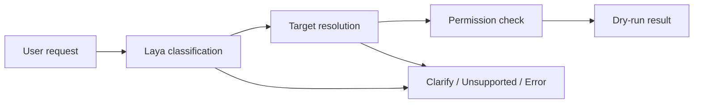

<h1 align="center">Laya Action Playground</h1>

<p align="center">
  <b>Natural-language requests. Typed actions. Explicit permissions.</b>
</p>

<p align="center">
  A local playground for exploring how Laya AI translates requests into application actions—before connecting it to a real system.
</p>

<p align="center">
  
  
  
</p>

<p align="center">
  <a href="#-quick-start">Quick Start</a> ·
  <a href="#-how-it-works">How It Works</a> ·
  <a href="#-usage--permissions">Usage &amp; Permissions</a> ·
  <a href="#-evaluation--results">Evaluation &amp; Results</a>
</p>

<br>

## 🔎 The Problem

Recognizing a request is only part of translating it into an action. The target must be understood, permissions must be checked, and mistakes must be measurable.

<table width="100%">
  <tr>
    <td width="33%" valign="top">
      <h3 align="center">Action Recognition</h3>
      <p align="center">Similar requests can mean different things: viewing email groups, editing one, or creating a new one.</p>
    </td>
    <td width="33%" valign="top">
      <h3 align="center">Permission Boundaries</h3>
      <p align="center">The same action may be allowed for one user and denied for another, depending on role and group membership.</p>
    </td>
    <td width="33%" valign="top">
      <h3 align="center">Measurable Behavior</h3>
      <p align="center">A confident prediction is not necessarily correct. Classification errors and permission decisions need separate evaluation.</p>
    </td>
  </tr>
</table>

<br>

## 💡 The Solution

Laya Action Playground maps requests to **20 supported actions**, resolves their targets, and checks an explicit permission policy—all without changing real data.

- **Real local inference:** English Laya weights running on CPU, not a keyword-matching replacement or hosted AI API.
- **Interactive exploration:** A Streamlit UI with acting-user and fallback-target selectors, confidence controls, and raw model output.
- **Repeatable evaluation:** Hand-labelled scenarios, independent permission checks, and downloadable JSON/HTML reports.
- **Dry-run only:** Users and Django-style groups are in-memory fixtures. Django itself is not installed, and no real action handler is invoked.

<br>

## 🚀 Quick Start

### Install and launch

The tested interpreter is **Python 3.14.3**. With Python, `uv`, and `make` available, run from the project root:

```bash
make setup              # Install dependencies from uv.lock
make webui              # Start the local playground
```

Open **[http://127.0.0.1:8501](http://127.0.0.1:8501)**. The UI runs in the foreground; stop it with **Ctrl+C**. The server binds to localhost and Streamlit usage telemetry is disabled.

Run `make setup` once before the other commands. They never install dependencies implicitly. The first **Load / verify local model**, translation, or evaluation downloads the English checkpoint; loading failures are shown rather than replaced with fake predictions.

### Everyday commands

| Command | Purpose |
| :--- | :--- |
| `make` or `make help` | List commands and override examples |
| `make setup` | Install locked dependencies, including CPU-only PyTorch |
| `make test` | Run offline software tests |
| `make webui` | Start the localhost browser UI |
| `make evaluate` | Evaluate all scenarios at threshold **0.80**; save to `reports/` |
| `make evaluate-ungated` | Evaluate at threshold **0**; save to `reports/ungated/` |
| `make smoke` | Evaluate three cases; save to `reports/smoke/` |

<details>
<summary><b>Configuration, offline mode, and direct Python commands</b></summary>

Override settings on the Make command line:

```bash
make webui PORT=8502
make evaluate THRESHOLD=0.5 REPORT_DIR=reports/custom
make test TEST_ARGS="-q -k permission"
make test PYTHON=/absolute/path/to/venv/bin/python
```

`PYTHON` defaults to `.venv/bin/python`. `REPORT_DIR` overrides the exact output directory, including for `smoke` and `evaluate-ungated`.

Initial setup needs internet access for packages and weights. After downloading the model, force cache-only loading:

```bash
HF_HUB_OFFLINE=1 make webui
HF_HUB_OFFLINE=1 make evaluate
```

Cached weights occupy roughly **0.8 GB**, with the installed environment roughly **1.3 GB**. Caches and the environment are ignored by version control. Model weights default to `.cache/huggingface`; existing `HF_HOME` and `TORCH_HOME` values override project-local cache locations.

The project environment is configured in PyCharm. Running `main.py` there also launches the playground. Equivalent direct commands are:

```bash
uv sync --locked
.venv/bin/python main.py
HF_HUB_OFFLINE=1 .venv/bin/python main.py
.venv/bin/python -m pytest -q

# Full real-model evaluation:
HF_HUB_OFFLINE=1 .venv/bin/python main.py --evaluate
# Diagnostic comparison with confidence gating disabled; still dry-run only:
HF_HUB_OFFLINE=1 .venv/bin/python main.py --evaluate --threshold 0 --report-dir reports/ungated
# Three-case smoke test:
HF_HUB_OFFLINE=1 .venv/bin/python main.py --evaluate --limit 3 --report-dir reports/smoke
```

</details>

<br>

## ⚙️ How It Works

The playground and evaluator share the same translation pipeline in [pipeline.py](pipeline.py).



1. **Classify the request:** Laya selects a family: view, edit, add, unsupported, ambiguous, multiple, or no-action.
2. **Choose the action:** Laya selects within that family, with a none-matches option. Families avoid one large action-choice question.
3. **Resolve the target:** Laya classifies references against the fixture directory; application code applies explicit references and fallbacks.
4. **Check permissions:** Application code checks the exact action/user/group against a deterministic policy. No action is executed.

The result exposes `action`, `target`, `status`, `reason`, `scores`, `raw`, `threshold`, `inference_ms`, and `elapsed_ms`. Status is `allowed`, `denied`, `needs_clarification`, `unsupported`, or `error`. Denied predictions remain visible.

`inference_ms` includes model calls and adapter overhead but excludes model loading. `elapsed_ms` covers the complete request.

**Confidence is experimental.** The default **0.80** threshold applies to each question's `answer_confidence`; it is not a validated correctness guarantee. Lower thresholds admit more predictions and can expose confident mistakes. Negation, unsupported operations, and multiple actions are model classifications, not proven semantic guards. An `allowed` result means only that the **predicted** action and target passed the stub policy—not that the input was understood correctly.

Actual load warnings, model revision, package versions, and device appear in reports. The downloaded checkpoint emits a temperature-calibration warning for the `choice:11+` bucket; the UI displays it rather than suppressing it. No fine-tuning is performed.

<br>

## 🧩 Tech Stack

| Component | Technology | Role |
| :--- | :--- | :--- |
| **Language** | Python 3.14 | Application, fixtures, and evaluation |
| **Decision model** | Laya 0.4.13, English checkpoint | Typed choices and probabilities |
| **Inference** | CPU-only PyTorch and Transformers | Local model loading and execution |
| **Web UI** | Streamlit | Request playground, policy reference, and reports |
| **Permissions** | Plain Python, in-memory users/groups | Deterministic authorization without Django |
| **Testing** | pytest and Streamlit AppTest | Offline policy, pipeline, reporting, and UI checks |
| **Tooling** | uv, `uv.lock`, and Make | Reproducible dependencies and command shortcuts |

<br>

## 👥 Usage & Permissions

### Try a request

1. **Choose the acting user.** Role and memberships come exclusively from the fixture directory, never request text.
2. **Select optional fallback targets.** Personal actions otherwise default to self; group actions default to the actor's sole group. Sam belongs to both groups and needs a selected or explicitly named group for group actions.
3. **Enter one request**, such as `Show my group's alarm rules`, `Change my password`, or `Create a software alarm rule in Beta`.
4. **Inspect the result:** predicted action, target, permission status, probability distributions, timing, and raw model response.

Explicit text references override selectors. A named user and explicitly named group must agree. Unknown or conflicting references require clarification rather than silently using a fallback. Personal actions ignore the group selector; group actions ignore the user selector. Manuals and video guides need no target.

### Stub identities

| User | Role | Groups |
| :--- | :--- | :--- |
| Alice | Regular | Alpha |
| Marc | Manager | Alpha |
| Bob | Regular | Beta |
| Maya | Manager | Beta |
| Sam | Superuser | Alpha, Beta |

### Permission policy

| Capability | Regular | Manager | Superuser |
| :--- | :--- | :--- | :--- |
| Manuals and video guide | Allowed | Allowed | Allowed |
| Other `view_*` actions | Own group | Own group | Any group |
| Password, personal details, notifications, profile | Self | Self | Any user |
| `edit_email_group` and all five `add_*` actions | Denied | Own group | Any group |

`add_user` creates an ordinary user in a group; it does not grant role elevation. Deletion, promotion, and moving users between groups are unsupported. The full 20-action catalogue is in [domain.py](domain.py) and the UI's **Actions & policy** tab.

This prototype policy is **not Django's `is_staff` flag**. Future Django integration should obtain identity and groups from the authenticated backend and retain the deterministic authorization boundary.

### Prototype boundaries

Inputs are limited to **600 characters**. Model-reported context truncation also requires a shorter request. The prototype does **not** extract passwords, email addresses, alarm conditions, or complete API payloads: it evaluates action identity and authorization, not execution.

<br>

## 📊 Evaluation & Results

Use **Automatic evaluation → Run base evaluation** in the UI, or run `make evaluate`.

The baseline contains **79 hand-labelled cases**: three phrasings per action plus role/group boundaries, selector precedence, role spoofing, ambiguity, negation, unknown targets, and multiple actions. Evaluation uses fixed actors and targets; only the sidebar threshold applies. Expected labels never come from model output.

### Observed model baseline

Real cached English-model inference with **Laya 0.4.13 on CPU**, measured in this workspace:

| Confidence threshold | Exact end-to-end matches | Action accuracy | Clarification rate |
| :--- | :--- | :--- | :--- |
| **0.80** — default | 11/79 (13.9%) | 50.6% | 91.1% |
| **0.00** — diagnostic | 57/79 (72.2%) | 78.5% | 7.6% |

Both runs completed without inference errors. Independent policy checks on labelled targets matched **100%**; that does not imply that Laya always selected the correct action or target. Threshold zero exposes classification errors, while 0.80 rejects many useful predictions. Neither threshold is calibrated for this domain, and these fixtures are not a held-out production validation set.

### Reports and metrics

CLI reports are written to `reports/evaluation.json` and `reports/evaluation.html`; ungated reports go to `reports/ungated/`. The UI provides JSON and standalone HTML downloads.

Reports include expected/actual results, raw model responses in JSON, per-action accuracy, a confusion matrix, abstention rate, mean/median/p95 warm-request latency, model-loading time, versions, and revision. One unscored request warms the model before evaluation. Timings describe the current machine, not a published benchmark. Initial comparison latency included some host contention; run evaluations sequentially for performance comparisons.

<details>
<summary><b>Metric definitions and exit codes</b></summary>

| Metric | Meaning |
| :--- | :--- |
| **Action accuracy** | The predicted action matches the label, even if a later target-confidence check abstains. A family-stage abstention has no action prediction and counts as incorrect when an action was expected. |
| **End-to-end accuracy** | Action, resolved target, and final status all match. |
| **Authorization accuracy on oracle targets** | Deterministic policy is checked against fixture-labelled actions and targets, independently of model mistakes. |
| **End-to-end permission status accuracy** | Final status matches cases labelled allowed/denied, including translation or target failures. |
| **Abstention rate** | Fraction returning `needs_clarification`, including deliberately ambiguous cases. |

Model failures become error rows, not fabricated predictions. The evaluation CLI returns **1** for runtime/model errors and **0** for a completed run even when accuracy is poor. Make preserves those success/failure semantics: inspect the report rather than treating a successful command as an accuracy guarantee.

</details>

### Offline software verification

**443 tests passed** in the recorded verification run. This is separate from model accuracy.

Run `make test` without weights or network access. Coverage includes the complete action/role/user/group permission matrix, invalid targets, pipeline gates and precedence, malformed model responses, report failures, fixture coverage, and Streamlit rendering/input validation. Scripted model outputs appear **only in pipeline unit tests**, never live evaluation.

A third-party Streamlit/Pandas deprecation warning appears during chart rendering; it does not affect the report.

<br>

## 🗺️ Roadmap

- [x] **Local inference:** Run the actual English Laya model on CPU.
- [x] **Action catalogue:** Classify requests against 20 supported actions.
- [x] **Permission prototype:** Stub users/groups and deterministic role-based checks.
- [x] **Web playground:** Explore requests, confidence scores, and raw outputs.
- [x] **Evaluation:** Labelled scenarios, independent policy checks, and portable reports.
- [x] **Developer tooling:** Make commands, locked dependencies, and offline tests.
- [ ] **Django integration:** Connect authenticated users and real group membership.
- [ ] **Execution:** Extract complete action payloads and connect real handlers.
- [ ] **Model improvement:** Fine-tune and calibrate on separate domain data.
- [ ] **Further exploration:** Evaluate multilingual checkpoints and inspect Laya internals.

Future integration can build on the isolated model adapter and permission functions. Unchecked items are outside the current prototype.

<br>

## 🤝 Acknowledgements

- **[Laya upstream](https://github.com/NandhaKishorM/laya)** for the decision model and inference package.
- **The open-source Python ecosystem**, including PyTorch, Transformers, Streamlit, pytest, and uv.
- **[REACH](https://github.com/dmunish/reach#readme)** for the README's visual and structural inspiration. Its branding and project imagery are not reused.

[Laya AI](https://laya-ai.com/) is a community resource; use the upstream project for implementation details.

<p align="center">
  <sub>Built to explore local decisions before connecting them to real actions.</sub>
</p>
